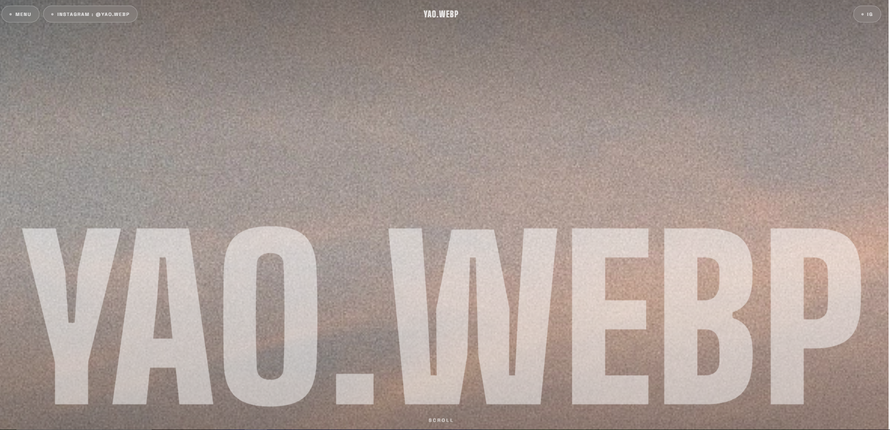
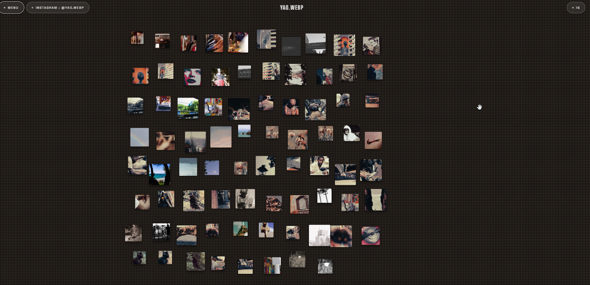
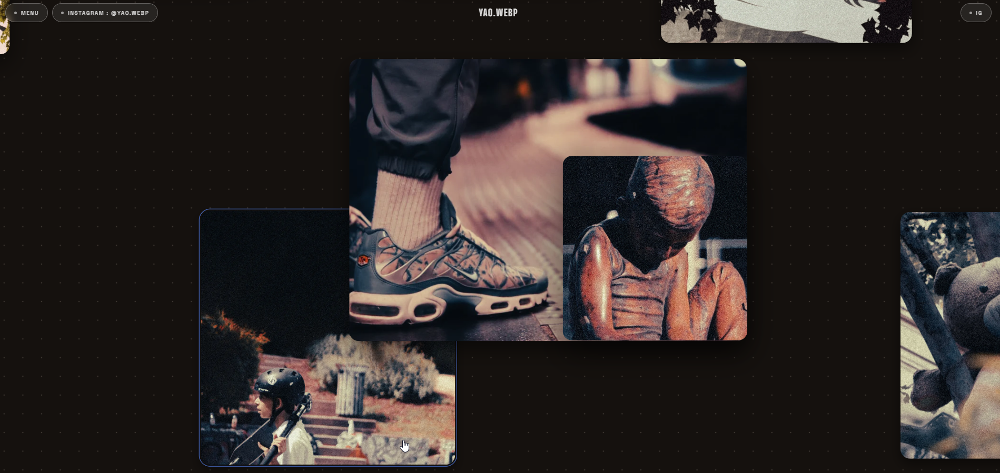
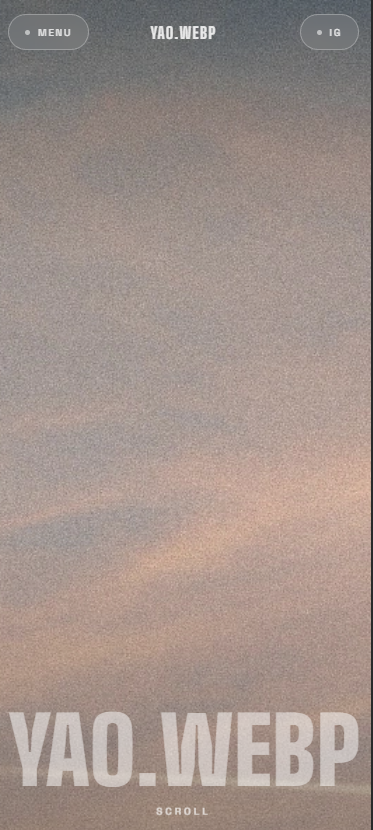
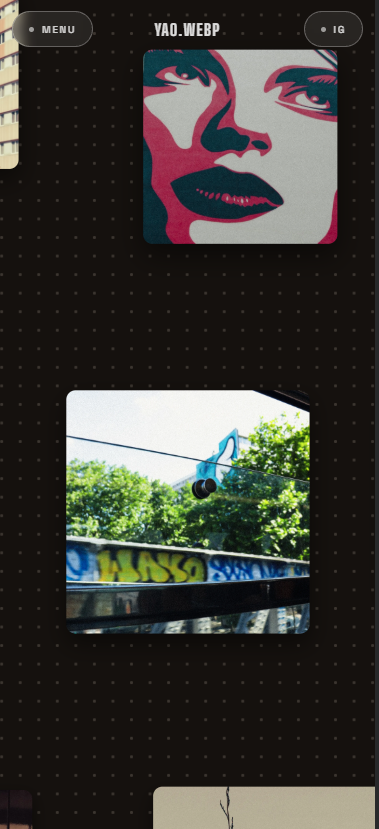

# Yao.WEBP — Portfolio photo

Un portfolio de photographie pensé comme une expérience : une landing immersive, puis une galerie infinie où l'on se balade librement entre les photos.
Instagram : [@yao.webp](https://www.instagram.com/yao.webp)



## L'intro

À l'arrivée, un flash puis un défilé rapide de photos aux mêmes tons, qui se fondent les unes dans les autres jusqu'à la photo de la landing. On peut la passer d'un tap ou d'un clic.

## La galerie

Toutes les photos sont posées en vrac sur un canvas infini. On glisse pour se déplacer, on zoome à la molette ou en pinçant.



En zoomant, les photos se chevauchent sur des plans différents, ce qui crée du relief. On peut cliquer une photo pour la déplacer ou la redimensionner.



## Sur mobile

<p>
  
  &nbsp;&nbsp;
  
</p>

## Technologies


HTML5, CSS3 et JavaScript pur (sans framework). Polices : Big Shoulders Display et Space Grotesk. Photos au format WebP.

## Lancer le site

Site statique (HTML, CSS, JavaScript), sans installation :

```bash
python -m http.server 8765   # puis ouvrir http://localhost:8765/
```

## Inspirations

[Goldlight](https://lovable.dev/templates/websites/music/goldlight-artist-musician-portfolio-template) pour la landing et [Inspo Canvas](https://lovable.dev/templates/apps/saas/inspo-canvas-visual-moodboard-creator-template) pour le canvas de photos.

© Yao.WEBP — photos non réutilisables sans autorisation.
